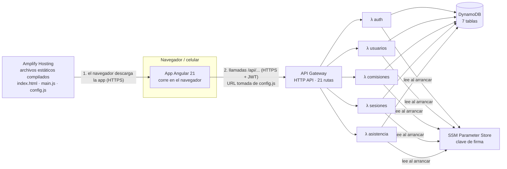

# Despliegue en AWS: Presentismo

Este documento explica cómo está desplegado Presentismo en AWS con una arquitectura **serverless**. Cubre los servicios usados y por qué, la organización del backend, el modelo de datos en DynamoDB, la seguridad, los costos y la operación.

---

## Índice

1. [URLs](#1-urls)
2. [Arquitectura](#2-arquitectura)
3. [Lambdas y rutas](#3-lambdas-y-rutas)
4. [Organización del backend (por capas)](#4-organización-del-backend-por-capas)
5. [Modelo de datos en DynamoDB](#5-modelo-de-datos-en-dynamodb)
6. [Seguridad](#6-seguridad)
7. [Cambios respecto de la versión original](#7-cambios-respecto-de-la-versión-original)
8. [Prueba de punta a punta](#8-prueba-de-punta-a-punta)
9. [Costos](#9-costos)
10. [Comandos de operación](#10-comandos-de-operación)
11. [Problemas encontrados](#11-problemas-encontrados)
12. [Glosario](#12-glosario)

---

## 1. URLs

| | |
|---|---|
| **App (frontend)** | https://main.d148i35bp5iviz.amplifyapp.com |
| **API** | https://h2avqrc6j1.execute-api.us-east-1.amazonaws.com |
| Región | `us-east-1` (Norte de Virginia) |
| Stack de CloudFormation | `PresentismoStack` |

---

## 2. Arquitectura



### Cómo fluye un pedido

1. **Carga de la app.** Al entrar a la URL de Amplify, el navegador descarga los archivos estáticos que generó `ng build`: `index.html`, el JS y el CSS compilados, y `config.js`. Amplify solo entrega archivos y no ejecuta lógica.
2. **Llamadas al backend.** Ese Angular compilado corre en el navegador y desde ahí llama a la API:
   - `config.js` define `window.__API_URL__` con la URL de API Gateway. El script `infra/scripts/deploy-frontend.ts` lo genera al desplegar.
   - El interceptor HTTP (`core/auth.interceptor.ts`) le agrega esa URL a cada pedido `/api/...`.
   - La app (`*.amplifyapp.com`) y la API (`*.execute-api.amazonaws.com`) están en dominios distintos, por eso API Gateway tiene **CORS** habilitado para el dominio de Amplify.
3. **Backend.** API Gateway mira la ruta y llama a la Lambda del módulo que corresponde. Esa Lambda lee y escribe en DynamoDB.

### Servicios

| Servicio | Uso |
|---|---|
| **Amplify Hosting** | Sirve el Angular compilado con HTTPS y CDN. Tiene una regla de reescritura para que las rutas de Angular (`/docente`, `/alumno`, …) devuelvan `index.html`. |
| **API Gateway (HTTP API)** | Expone 21 rutas `/api/...`, cada una conectada a la Lambda de su módulo. El CORS solo admite el dominio de Amplify y `localhost:4200`. Tiene un límite de 50 req/s, con ráfagas de 100, para proteger la cuenta. |
| **Lambda (×5)** | Una función por módulo: Node.js 22, ARM (Graviton), 512 MB. |
| **DynamoDB (×7 tablas)** | Base NoSQL. Está en modo provisionado para entrar en el tier gratuito permanente. |
| **SSM Parameter Store** | Guarda, como SecureString, la clave maestra con la que se firman los JWT de login y los tokens del QR. |
| **CloudWatch Logs** | Logs de cada Lambda, con retención de 1 semana. |
| **IAM** | Cada Lambda tiene un rol de **mínimo privilegio**: solo puede leer y escribir las tablas que usa. |

**¿Por qué serverless?** No hay servidores prendidos: cada Lambda corre solo cuando llega un pedido. Para un sistema que se usa en horario de clase, eso significa costo prácticamente cero, sin mantenimiento de servidores y con escalado automático si muchos alumnos escanean a la vez.

---

## 3. Lambdas y rutas

| Lambda | Rutas | Roles | Tablas (L = lectura, E = escritura) |
|---|---|---|---|
| `presentismo-auth` | `POST /api/auth/login`, `GET /api/auth/me` | público / logueado | usuarios, usuariosEmail (L) |
| `presentismo-usuarios` | `GET`, `POST /api/usuarios`, `PATCH /api/usuarios/{id}` | ADMIN | usuarios, usuariosEmail, contadores (L/E) |
| `presentismo-comisiones` | `GET`, `POST /api/comisiones`, `PATCH`, `DELETE /api/comisiones/{id}`, `PATCH .../{id}/estado`, `GET .../{id}/sesiones`, `GET`, `POST .../{id}/inscripciones`, `DELETE .../{id}/inscripciones/{alumnoId}` | ADMIN, DOCENTE | comisiones, inscripciones, contadores (L/E); usuarios, sesiones, asistencias (L) |
| `presentismo-sesiones` | `POST /api/sesiones/abrir-qr`, `GET /api/sesiones/{id}`, `GET .../{id}/qr`, `POST .../{id}/cerrar`, `DELETE /api/sesiones/{id}` | DOCENTE (también ADMIN para ver, cerrar y borrar) | sesiones, comisiones, asistencias, contadores (L/E); usuarios, inscripciones (L) |
| `presentismo-asistencia` | `POST /api/asistencia/registrar-qr`, `GET /api/asistencia/alumno/me` | ALUMNO | asistencias (L/E); usuarios, sesiones, comisiones, inscripciones (L) |

---

## 4. Organización del backend (por capas)

```
backend/src/
├── modules/                      # una carpeta = una Lambda
│   ├── auth/        handler.ts + auth.service.ts
│   ├── usuarios/    handler.ts + usuarios.service.ts
│   ├── comisiones/  handler.ts + comisiones.service.ts
│   ├── sesiones/    handler.ts + sesiones.service.ts
│   └── asistencia/  handler.ts + asistencia.service.ts
├── repositories/                 # ÚNICA capa que habla con DynamoDB
│   ├── usuarios.repository.ts
│   ├── comisiones.repository.ts
│   ├── inscripciones.repository.ts
│   ├── sesiones.repository.ts
│   └── asistencias.repository.ts
└── shared/
    ├── http.ts        # mini-router: routeKey de API Gateway → función, auth por rol, manejo de errores
    ├── auth.ts        # firma y validación del JWT de login
    ├── qr.ts          # firma y validación del token del QR
    ├── secrets.ts     # lee la clave maestra de SSM y deriva 2 claves con HMAC
    ├── db.ts          # cliente DynamoDB, paginación, batch, contadores
    ├── config.ts      # variables de entorno (nombres de tablas, tiempos del QR, zona horaria)
    └── fechas.ts, validation.ts, errors.ts
```

- **handler** → recibe el evento de API Gateway y llama al service.
- **service** → reglas de negocio: permisos, estados y validaciones.
- **repository** → lecturas y escrituras en DynamoDB.

No se usa Express. API Gateway ya resuelve la ruta y le pasa a la Lambda el `routeKey` (por ejemplo `"GET /api/comisiones/{id}"`), así que cada Lambda tiene un mapa de ruta a función en `shared/http.ts`.

---

## 5. Modelo de datos en DynamoDB

| Tabla | Clave primaria | Índice secundario (GSI) | Para qué |
|---|---|---|---|
| `Usuarios` | `id` (N) | — | Datos del usuario y hash bcrypt de la contraseña |
| `UsuariosEmail` | `email` (S) | — | Relaciona email con id. Hace que el **email sea único** y se usa en el login. |
| `Comisiones` | `id` (N) | `porDocente` (docenteId, id) | Aulas. Guarda `sesionActivaId`. |
| `Inscripciones` | `comisionId` + `alumnoId` | `porAlumno` (alumnoId, comisionId) | Qué alumno está en qué aula |
| `Sesiones` | `id` (N) | `porComision` (comisionId, id) | Clases con QR (fecha, activa, expira) |
| `Asistencias` | `sesionId` + `alumnoId` | `porAlumno` (alumnoId, sesionId) | PRESENTE / AUSENTE por clase |
| `Contadores` | `nombre` (S) | — | Ids autoincrementales |

### Cómo se reemplazó lo que daba SQL Server

La versión original usaba SQL Server. DynamoDB no es relacional, así que lo que antes resolvía la base ahora se resuelve así:

| En SQL Server (versión original) | En DynamoDB |
|---|---|
| `IDENTITY` (ids autoincrementales) | Tabla `Contadores` con `UpdateItem ADD valor 1` (atómico) |
| `UNIQUE (email)` | Tabla `UsuariosEmail`, cuya **clave** es el email, escrita con `TransactWriteItems` y la condición `attribute_not_exists` |
| `UNIQUE (comision_id, alumno_id)` | Lo garantiza la clave compuesta de la tabla |
| Índice único filtrado "una sesión activa por aula" | Atributo `sesionActivaId` en la comisión, escrito con condición dentro de una **transacción** |
| `UPDATE ... WHERE estado = 'AUSENTE'` (presente atómico) | `UpdateItem` con `ConditionExpression: attribute_not_exists OR estado = AUSENTE` |
| `JOIN` y `COUNT(*)` | Consultas por índice más `BatchGetItem` / `Select: COUNT`, combinadas en el service |

---

## 6. Seguridad

- **Login:** las contraseñas se guardan con **bcrypt**. El tiempo de respuesta es el mismo exista o no el email, así no se revela qué emails están registrados.
- **JWT (HS256, 8 h):** en cada request también se consulta la base. Por eso **desactivar a un usuario le corta el acceso al instante**, y el rol que vale es el de la base.
- **QR anti-captura:** el QR contiene un token firmado que **vence a los 40 segundos** y se renueva cada 20. Una captura de pantalla reenviada a alguien que no está en el aula enseguida deja de servir.
- **Claves separadas:** de la clave maestra guardada en SSM se derivan con HMAC dos claves distintas, una para el login y otra para el QR. Así un token de login nunca sirve como QR, ni al revés.
- **El alumno sale del JWT**, no del body: nadie puede marcar presente "en nombre de" otro.
- **Mínimo privilegio en IAM**, CORS restringido y límite de requests en API Gateway.
- **Ningún secreto en el código:** la clave de firma se genera al desplegar (`scripts/crear-clave.ts`) y vive solo en SSM.

---

## 7. Cambios respecto de la versión original

La versión original era Express + SQL Server. La migración a serverless implicó:

**Eliminado:**
- `backend/src/app.ts`, `index.ts`, `config.ts`, `errors.ts`, `validation.ts`
- `backend/src/db/*` (pool, seed, setup, sql) y `backend/src/middleware/auth.ts`
- `backend/src/routes/*.routes.ts` (rutas con el SQL adentro, sin capas)
- `backend/src/services/qr.service.ts` y `backend/test/*`
- `infra/database-schema.sql` y `backend/.env.example`

**Agregado:**
- `backend/src/modules/*` → handler y service de cada Lambda
- `backend/src/repositories/*` → acceso a DynamoDB
- `backend/src/shared/*` → código común
- `backend/scripts/seed.ts` → carga los datos de demo en DynamoDB
- `infra/` → proyecto **AWS CDK**: `bin/app.ts`, `lib/presentismo-stack.ts`, `lib/constantes.ts`, `scripts/crear-clave.ts`, `scripts/deploy-frontend.ts`
- `frontend/public/config.js` → URL de la API, que se reemplaza al desplegar

**Modificado:**
- `backend/package.json` → se agregan las dependencias del AWS SDK (DynamoDB, SSM) y se quitan Express, mssql y msnodesqlv8
- `frontend/src/app/core/auth.interceptor.ts` → agrega la URL de la API a las rutas `/api/...`
- `frontend/src/index.html` → carga `config.js`
- `frontend/proxy.conf.json` → en desarrollo, `ng serve` reenvía `/api` a la API desplegada
- `.gitignore` → archivos generados por CDK (`infra/cdk.out/`, `infra/cdk-outputs.json`, `infra/cdk.context.json`)

> Fuera de esos cambios, el frontend Angular **no se modificó**: las respuestas de la API mantienen exactamente el mismo formato que la versión original.

---

## 8. Prueba de punta a punta

| Prueba | Resultado |
|---|---|
| La web carga y una ruta de Angular (`/docente`) responde | 200 |
| `config.js` publicado con la URL de la API | OK |
| CORS desde el dominio de Amplify | OK |
| El docente lista sus aulas | OK (1 aula, 2 inscriptos) |
| El docente abre una sesión QR | 201 |
| El alumno escanea el QR | 201 PRESENTE |
| El alumno escanea de nuevo | 409 YA_REGISTRADO |
| El docente intenta escanear | 403 SIN_PERMISO |
| Detalle de la sesión | 1 presente, 1 ausente |
| Panel del alumno | 100 % de asistencia |

---

## 9. Costos

| Recurso | Tier gratuito | Costo estimado |
|---|---|---|
| Lambda | ✅ Gratis siempre (1 M requests + 400.000 GB-s/mes) | 0 |
| DynamoDB provisionado (17 RCU / 13 WCU) | ✅ Gratis siempre (hasta 25 RCU + 25 WCU + 25 GB) | 0 |
| SSM Parameter Store estándar | ✅ Gratis siempre | 0 |
| CloudWatch Logs (retención 1 semana) | ✅ Gratis siempre (5 GB/mes) | 0 |
| API Gateway HTTP API | ⚠️ Primer año (1 M llamadas/mes) | ~0 |
| Amplify Hosting | ⚠️ Primer año | ~0 |

**Decisiones tomadas para no gastar:**
- **SSM Parameter Store** en lugar de Secrets Manager, que cobra USD 0,40/mes por secreto.
- **DynamoDB en modo provisionado** en lugar de on-demand, que no entra en el tier gratuito permanente. Si se crean otras tablas provisionadas en la misma cuenta, **el total no puede pasar de 25 RCU / 25 WCU**.
- **Lambdas en ARM (Graviton)**, ~20 % más baratas.
- Logs con retención de 1 semana.

---

## 10. Comandos de operación

> Requieren credenciales de la cuenta de AWS donde está desplegado. Antes de correrlos, iniciar sesión en la CLI con `aws login --profile <perfil>` y exportar `AWS_PROFILE=<perfil>`.

| Qué | Dónde | Comando |
|---|---|---|
| Desplegar backend e infraestructura | `infra/` | `npm run deploy` |
| Publicar el frontend | `infra/` | `npm run deploy:frontend` |
| Recargar los datos de demo (**borra todo**) | `backend/` | `npm run seed` |
| Ver cambios antes de desplegar | `infra/` | `npm run diff` |
| Borrar todo de AWS (incluye los datos) | `infra/` | `npm run destroy` |
| Frontend en local, contra la API de AWS | `frontend/` | `npm start` |

**Primera vez en otra PC:**

```bash
cd infra && npm install
cd ../backend && npm install
cd ../frontend && npm install
```

`npm run deploy` genera `infra/cdk-outputs.json`, con las URLs y los nombres de las tablas. Ese archivo lo usan el seed y el deploy del frontend, y no se sube al repo.

---

## 11. Problemas encontrados

| Problema | Causa | Solución |
|---|---|---|
| Secrets Manager no es gratis | Cobra USD 0,40/mes por secreto | Se reemplazó por SSM Parameter Store |
| DynamoDB on-demand no entra en el tier gratuito | El tier permanente es solo para capacidad provisionada | Tablas en modo provisionado (17/13 de 25/25) |

---

## 12. Glosario

| Término | Qué es |
|---|---|
| **Amplify Hosting** | Servicio que publica sitios web estáticos (como un Angular compilado) con HTTPS y CDN. |
| **API Gateway (HTTP API)** | "Puerta de entrada" HTTP: recibe los requests y los manda a la Lambda que corresponde. |
| **Lambda** | Función que AWS ejecuta solo cuando llega un request. No hay un servidor prendido y se paga por uso. |
| **Cold start** | La primera ejecución de una Lambda después de un rato tarda más, porque tiene que arrancar el contenedor. |
| **DynamoDB** | Base de datos NoSQL clave-valor de AWS. No tiene JOINs: se diseña según las consultas que se van a hacer. |
| **GSI** | Índice secundario global de DynamoDB: permite consultar la tabla por otra clave. |
| **RCU / WCU** | Unidades de capacidad de lectura y escritura provisionadas de DynamoDB. |
| **SSM Parameter Store** | Almacén de configuración y secretos, gratis en el nivel estándar. |
| **IAM** | Usuarios, roles y permisos de AWS. |
| **CloudFormation** | Servicio que crea recursos a partir de una plantilla (infraestructura como código). |
| **AWS CDK** | Herramienta para escribir esa infraestructura en TypeScript. Genera la plantilla de CloudFormation. |
| **Stack** | Conjunto de recursos que CloudFormation crea y borra juntos. |
| **CORS** | Regla del navegador: una página solo puede llamar a una API de otro dominio si esa API lo autoriza. |
| **JWT** | Token firmado que prueba quién es el usuario sin consultar una sesión en el servidor. |
